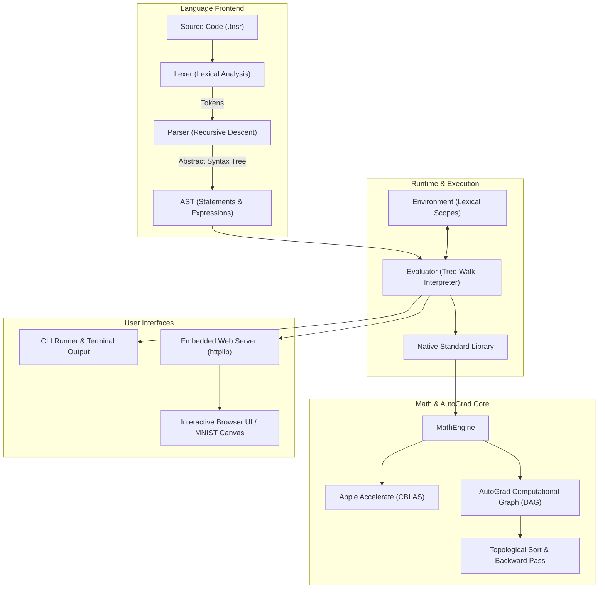
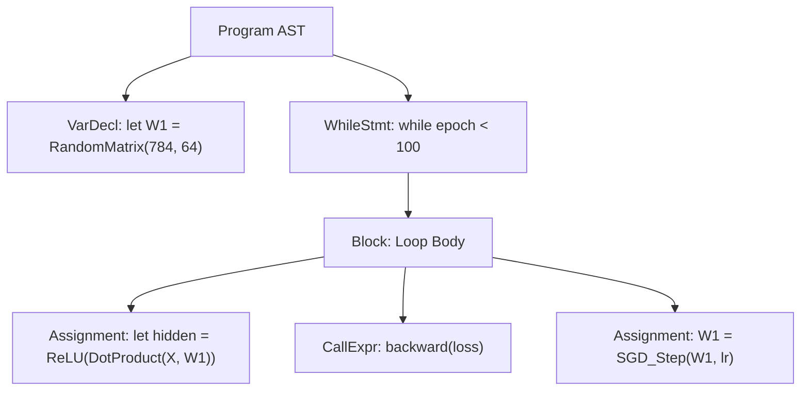
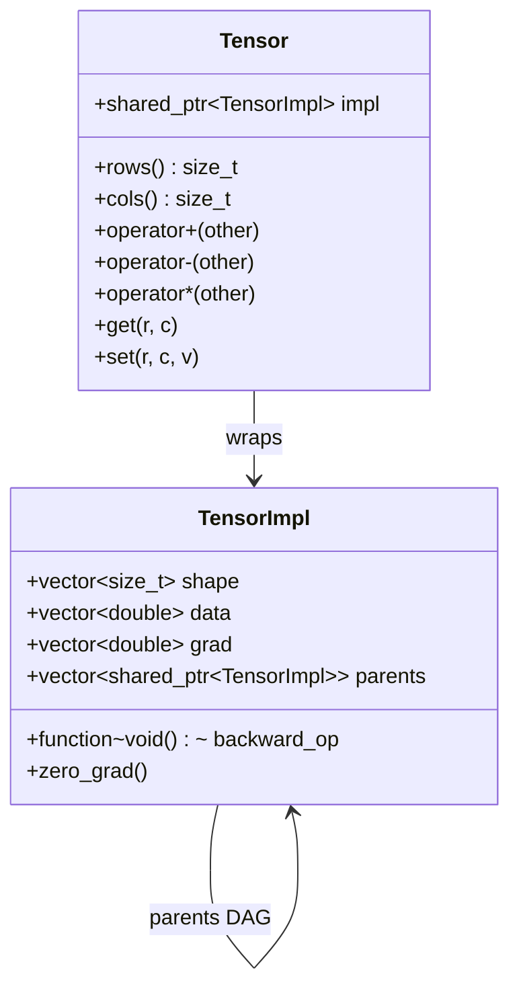
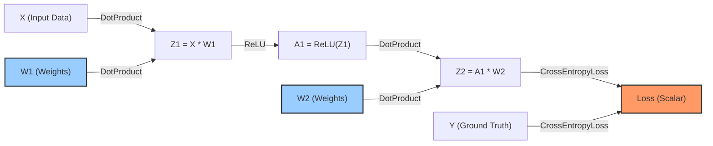
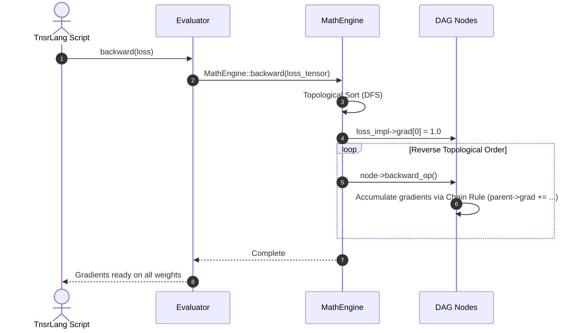
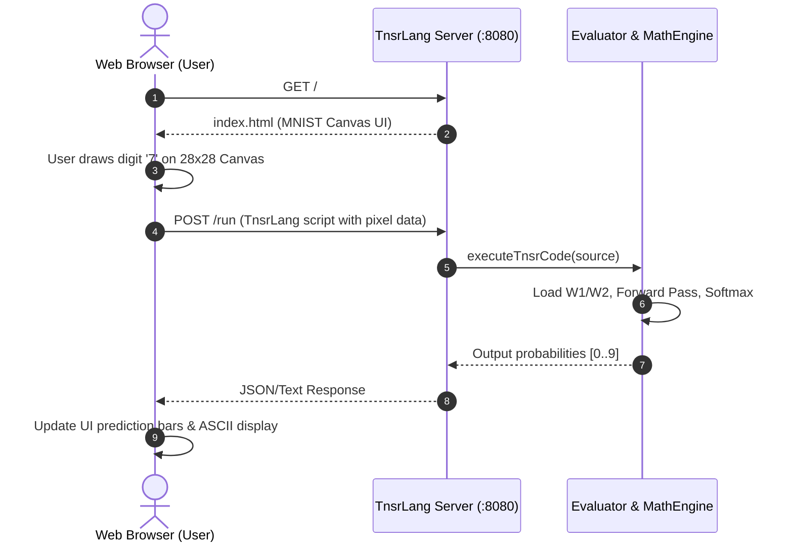

# TnsrLang Architecture & Deep Dive

This document provides a comprehensive technical overview of **TnsrLang**'s architecture, compiler design, evaluation pipeline, and the mathematical AutoGrad graph.

---

## 1. High-Level System Architecture

TnsrLang is designed as an educational, transparent, and modular domain-specific language (DSL) written from scratch in C++17. The system follows a clean pipeline:

---

## 2. Execution Pipeline

### Step 1: Lexical Analysis (`Lexer.h`, `Lexer.cpp`)
The `Lexer` scans raw source code character-by-character and produces a linear stream of strongly typed `Token` objects (e.g. `LET`, `IDENTIFIER`, `NUMBER`, `PLUS`, `WHILE`, `FN`). Comments (`//`) and whitespace are stripped automatically.

### Step 2: Parsing & AST Construction (`Parser.h`, `Parser.cpp`, `AST.h`, `AST.cpp`)
The `Parser` implements a **Recursive Descent Parser** that reads the token stream and verifies syntactic grammar rules. It constructs an **Abstract Syntax Tree (AST)** using modern C++ smart pointers (`std::unique_ptr<Stmt>` and `std::unique_ptr<Expr>`).

* **Statements (`Stmt`):** Variable declarations (`VarDecl`), assignments (`Assignment`), loops (`WhileStmt`, `ForStmt`), conditionals (`IfStmt`), function declarations (`FunctionStmt`), return statements (`ReturnStmt`), and expressions as statements (`ExprStmt`).
* **Expressions (`Expr`):** Binary operators (`BinaryExpr`), variables (`VariableExpr`), literals (`LiteralExpr`), function calls (`CallExpr`), arrays (`ArrayExpr`), and logical comparisons.

### Step 3: Evaluation & Environments (`Evaluator.h`, `Evaluator.cpp`)
The `Evaluator` is a **Tree-Walk Interpreter**. It traverses the AST recursively and evaluates statements in order:
* **Lexical Scoping (`Environment`):** Variables are stored in an `Environment` chain. Entering a function or block creates a child environment referencing its enclosing parent. When a scope exits, all local allocations are safely deallocated.
* **Native Function Decoupling:** Rather than hardcoding AI operations into grammar tokens, functions like `DotProduct`, `ReLU`, `Sigmoid`, `CrossEntropyLoss`, `LoadCSV`, and `SGD_Step` are registered as native C++ lambda bindings in the root environment.

---

## 3. The MathEngine & AutoGrad Engine

The mathematical foundation of TnsrLang is contained in `src/MathEngine.h` and `src/MathEngine.cpp`.

### Tensor & TensorImpl Design
To balance lightweight copying with shared ownership in computational graphs, tensors utilize a **Handle-Body Pattern**:

* `Tensor`: Value-type wrapper copied cheaply across the interpreter.
* `TensorImpl`: The heap-allocated object holding:
  1. `data`: Continuous flat `std::vector<double>`.
  2. `grad`: Accumulated gradient values for backpropagation.
  3. `parents`: Direct dependency links to the parent tensors that created it.
  4. `backward_op`: A lambda function storing the exact local derivative.

### Hardware Acceleration (Apple Accelerate BLAS)
For matrix-matrix multiplication (`DotProduct`), TnsrLang invokes Apple's native `cblas_dgemm` routine:
$$\mathbf{C} = \alpha \mathbf{A} \mathbf{B} + \beta \mathbf{C}$$
This leverages vector registers (SIMD) on Apple Silicon, delivering hardware-level performance while keeping the core C++ codebase clean.

---

## 4. Automatic Differentiation (The Backpropagation DAG)

### Building the Computational Graph (Forward Pass)
Whenever an arithmetic operator or math function is called, the result tensor registers its inputs in `parents` and attaches a `backward_op` closure:

### Topological Sort & Reverse Traversal (Backward Pass)
When `backward(loss)` is executed:
1. **Topological Sort (`build_topo`):** A Depth-First Search (DFS) traverses all reachable parent nodes in the DAG and sorts them in dependency order.
2. **Seed Gradient:** The loss tensor's gradient is initialized to `1.0`:
   $$\frac{\partial \mathcal{L}}{\partial \mathcal{L}} = 1.0$$
3. **Chain Rule Propagation:** The engine visits each node in reverse topological order, invoking `node->backward_op()` to compute upstream gradients and accumulate them into `parent->grad`:

### Memory Safety & Preventing Circular References
Because `TensorImpl` stores a `std::function<void()> backward_op`, capturing `shared_ptr<TensorImpl>` by value would form a circular reference (`TensorImpl -> backward_op -> TensorImpl`), preventing C++'s reference counter from reaching zero and causing a RAM leak.

**Solution:** Closures capture only non-owning raw pointers to the output node (`o_ptr = o_impl.get()`) while retaining `shared_ptr` to the parents (`a_impl`, `b_impl`). This guarantees that after `backward()` or when a variable goes out of scope, all intermediate memory is immediately reclaimed by the OS.

---

## 5. Web Playground & MNIST Visualizer Architecture

TnsrLang includes an embedded HTTP server based on `httplib.h`:

The web server allows live experimentation without external dependencies like Node.js or Python.
