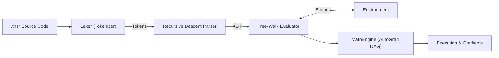

# TnsrLang

```text
 _______ _   _  _____ _____  _               _   _  _____ 
|__   __| \ | |/ ____|  __ \| |        /\   | \ | |/ ____|
   | |  |  \| | (___ | |__) | |       /  \  |  \| | |  __ 
   | |  | . ` |\___ \|  _  /| |      / /\ \ | . ` | | |_ |
   | |  | |\  |____) | | \ \| |____ / ____ \| |\  | |__| |
   |_|  |_| \_|_____/|_|  \_\______/_/    \_\_| \_|\_____|
```


**TnsrLang** is a lightweight, dynamically typed Domain-Specific Language (DSL) and interpreter written completely from scratch in standard C++17. It is designed for tensor mathematics, neural networks, and automatic differentiation (AutoGrad).

Instead of hiding the math behind massive library abstractions or opaque GPU backends, TnsrLang provides an educational, transparent, and modular "brutalist" environment where you can build, train, and inspect neural networks directly through clean code.

> **Featured Benchmark:** Check out the **[Real-World Showcase: Iris Classification (SHOWCASE.md)](SHOWCASE.md)** to see an end-to-end Multi-Layer Perceptron trained on real-world data with convergence curves, DAG diagrams, and performance benchmarks.

---

## Architecture Overview



For full details on the compiler, topological sort, memory management, and AutoGrad engine, see [ARCHITECTURE.md](ARCHITECTURE.md).

---

## Key Features

* **Zero External Dependencies**: Implemented in 100% portable C++17. Compiles cleanly on Linux, macOS, and Windows without external mathematical libraries.
* **AutoGrad Engine**: Built-in computational graph that tracks mathematical operations. Simply call `backward(loss)` and the engine computes gradients for all linked tensors via reverse topological backpropagation.
* **Standard Library for Neural Networks**: Built-in native functions for `DotProduct`, `Transpose`, `ReLU`, `Sigmoid`, `Softmax`, `CrossEntropyLoss`, `OneHot`, `Slice`, and `SGD_Step`.
* **Dynamic Lexical Scoping**: Full support for custom functions (`fn`), `while` loops, `for` loops, and conditionals (`if`/`else`).
* **Integrated Web Terminal & Canvas**: An embedded C++ HTTP server (`httplib`) that hosts an interactive browser terminal and an interactive 28x28 drawing canvas for real-time MNIST digit classification.
* **Model Persistence**: Native `Save()` and `Load()` capabilities to store and restore trained weights to disk.

---

## Quickstart

### Prerequisites
* Any standard C++17 compatible compiler (`clang++` or `g++`).

### Build

Using `clang++` or `g++`:
```bash
clang++ -std=c++17 -O3 src/*.cpp -o tnsrlang
```

Or using CMake:
```bash
mkdir -p build && cd build
cmake ..
make
cd ..
```

---

## Running Demos

### 1. XOR Neural Network
Train a multi-layer perceptron to learn the non-linear XOR logic gate:
```bash
./tnsrlang demo_xor.tnsr
```

### 2. MNIST Digit Recognition
Train a 2-layer neural network (784 -> 64 -> 10) on 1,000 handwritten digit samples using Cross-Entropy Loss:
```bash
./tnsrlang demo_mnist.tnsr
```

### 3. Fisher's Iris Flower Classification
Train an MLP (4 -> 16 -> 3) on the canonical 150-sample Iris dataset to classify flower species with >95% accuracy (see [SHOWCASE.md](SHOWCASE.md)):
```bash
./tnsrlang demo_iris.tnsr
```

### 4. Interactive Web Playground & MNIST Canvas
Launch the built-in HTTP server:
```bash
./tnsrlang --server
```
Open [http://localhost:8080](http://localhost:8080) in your browser:
* Draw digits with your mouse on the 28x28 canvas.
* Click **Predict** to run inference through your trained weights in real time.
* Visit [http://localhost:8080/playground.html](http://localhost:8080/playground.html) to write and execute arbitrary TnsrLang scripts directly in the web browser.

---

## Language Syntax at a Glance

```javascript
// 1. Initialize data & weights
let X = LoadCSV("mnist_train.csv")
let labels = Slice(X, 0, 1000, 0, 1)
let pixels = Slice(X, 0, 1000, 1, 785) * Vector([0.003921568]) // Normalize to 0-1
let Y = OneHot(labels, 10)

let W1 = RandomMatrix(784, 64)
let W2 = RandomMatrix(64, 10)
let lr = Vector([0.05])

// 2. Training Loop with AutoGrad
let epoch = 0
while epoch < 100 {
    let _ = ZeroGrad(W1)
    
    // Forward Pass
    let hidden = ReLU(DotProduct(pixels, W1))
    let logits = DotProduct(hidden, W2)
    let loss   = CrossEntropyLoss(logits, Y)
    
    // Backward Pass (Calculates gradients across the DAG)
    backward(loss)
    
    // Update Weights (Stochastic Gradient Descent)
    W1 = SGD_Step(W1, lr)
    W2 = SGD_Step(W2, lr)
    
    epoch = epoch + 1
}

// 3. Save Model
Save(W1, "W1.tnsrdata")
Save(W2, "W2.tnsrdata")
Print("Model trained and saved successfully!")
```

For complete syntax details, see the [Syntax Guide (SYNTAX.md)](SYNTAX.md).

---

## Project Structure

```text
.
├── src/
│   ├── Lexer.h / Lexer.cpp          # Tokenizer
│   ├── Parser.h / Parser.cpp        # AST builder
│   ├── AST.h / AST.cpp              # Syntax tree node definitions
│   ├── ASTPrinter.h / ASTPrinter.cpp# Graphviz DOT visualization
│   ├── Evaluator.h / Evaluator.cpp  # Tree-walk interpreter & stdlib
│   ├── MathEngine.h / MathEngine.cpp# Tensor logic, AutoGrad & matrix math
│   ├── httplib.h                    # Embedded single-header HTTP server
│   └── main.cpp                     # CLI entrypoint & web server
├── public/                          # Web UI assets & playground
│   ├── index.html                   # MNIST interactive canvas
│   └── playground.html              # Web script editor
├── demo_iris.tnsr                   # Fisher's Iris classification training
├── demo_mnist.tnsr                  # MNIST neural network training
├── demo_xor.tnsr                    # XOR problem training script
├── iris.csv                         # 150-sample Iris benchmark dataset
├── mnist_train.csv                  # 1000 MNIST training samples
├── xor_inputs.csv / xor_targets.csv # XOR dataset
├── vscode-extension/                # VS Code syntax highlighting bundle
├── ARCHITECTURE.md                  # Detailed architectural deep dive & diagrams
├── CORE_CONCEPTS.md                 # Fundamental math and neural net primer
├── SHOWCASE.md                      # Real-world benchmark: Iris classification
├── SYNTAX.md                        # Complete syntax guide & examples
└── CMakeLists.txt                   # Build configuration
```

---

## Documentation

* [Architecture Deep Dive (ARCHITECTURE.md)](ARCHITECTURE.md)
* [Real-World Showcase: Iris Classification (SHOWCASE.md)](SHOWCASE.md)
* [Syntax Guide (SYNTAX.md)](SYNTAX.md)
* [Core Concepts & Math Guide (CORE_CONCEPTS.md)](CORE_CONCEPTS.md)

---

## License
MIT License. Created by [tenri69](https://github.com/tenri69).
