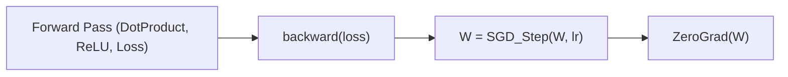

# TnsrLang Syntax Guide

**TnsrLang** is a custom, dynamically typed domain-specific language built specifically for tensor mathematics, neural networks, and automatic differentiation (AutoGrad).

---

## 1. Variables & Tensor Declarations

Variables are declared using the `let` keyword. Internally, scalars are stored as 1x1 tensors so that all arithmetic seamlessly interoperates.

```javascript
// Scalars (Internally treated as 1x1 Tensors)
let learning_rate = 0.05
let max_epochs = 100

// Vectors
let input = Vector([1.0, 2.0, 3.0])

// Matrices (Rows, Columns, [Elements...])
let weights = Matrix(2, 2, [
    0.1, 0.2, 
    0.3, 0.4
])

// Random Normal Initialized Matrix (Rows, Columns)
let W1 = RandomMatrix(784, 64)
```

---

## 2. Arithmetic & Broadcasting

Standard arithmetic operators work directly on tensors. Broadcasting rules apply automatically for matching dimensions or scalar expansion:

```javascript
let a = Vector([1.0, 2.0])
let b = Vector([3.0, 4.0])

// Element-wise operations
let sum  = a + b
let diff = a - b
let prod = a * b

// Scalar multiplication / broadcasting
let scaled = a * 0.5
let shifted = a + 1.0
```

---

## 3. Neural Network Standard Library

TnsrLang provides built-in native C++ functions optimized for deep learning models. All of these support automatic differentiation.

### Matrix Operations
```javascript
// Matrix Multiplication (Dot Product)
let logits = DotProduct(inputs, weights)

// Matrix Transpose
let w_transposed = Transpose(weights)

// Extract a specific row as a 1xCols tensor
let row0 = GetRow(inputs, 0)
```

### Activation Functions
```javascript
let relu_out    = ReLU(logits)      // max(0, x)
let sigmoid_out = Sigmoid(logits)   // 1 / (1 + e^-x)
let softmax_out = Softmax(logits)   // e^x_i / sum(e^x)
```

### Dataset Manipulation
```javascript
// Load CSV into a 2D Tensor
let data = LoadCSV("mnist_train.csv")

// Slicing: Slice(tensor, row_start, row_end, col_start, col_end)
let labels = Slice(data, 0, 1000, 0, 1)
let pixels = Slice(data, 0, 1000, 1, 785)

// One-Hot Encoding: OneHot(labels_tensor, num_classes)
let targets = OneHot(labels, 10)
```

### Loss Functions
```javascript
// Cross Entropy Loss with integrated numerically stable Softmax
let loss = CrossEntropyLoss(logits, targets)
```

---

## 4. Control Flow

### Conditionals (`if` / `else`)
```javascript
let loss_val = 0.005

if loss_val < 0.01 {
    Print("Converged successfully!")
} else {
    Print("Continuing training...")
}
```

### Loops
TnsrLang supports both `while` loops and range-based `for` loops.

```javascript
// While Loop
let epoch = 0
while epoch < 100 {
    epoch = epoch + 1
}

// For Loop (Inclusive range)
for i = 1 to 10 {
    Print(i)
}
```

---

## 5. Functions (`fn`)

Modularize logic using custom functions with the `fn` keyword. Functions support lexical scoping and can return values using `return`.

```javascript
fn dense_layer(X, W) {
    let z = DotProduct(X, W)
    return ReLU(z)
}

let hidden = dense_layer(inputs, weights)
```

---

## 6. AutoGrad & Optimization Workflow

TnsrLang manages a Directed Acyclic Graph (DAG) during the forward pass. Calling `backward(loss)` performs backpropagation across the entire graph.



```javascript
// 1. Reset gradients before backprop
let _ = ZeroGrad(W1)
let _ = ZeroGrad(W2)

// 2. Forward pass
let hidden = ReLU(DotProduct(X, W1))
let logits = DotProduct(hidden, W2)
let loss   = CrossEntropyLoss(logits, Y)

// 3. Compute gradients for all ancestors
backward(loss)

// 4. Update weights using Stochastic Gradient Descent
W1 = SGD_Step(W1, lr)
W2 = SGD_Step(W2, lr)
```

---

## 7. I/O & Persistence

```javascript
// Print text or tensor contents
Print("Training completed!")
Print(W1)

// Save weights to binary disk format
Save(W1, "W1.tnsrdata")

// Load saved weights
let restored_W1 = Load("W1.tnsrdata")
```

---

## 8. Complete Working Example: XOR Network

```javascript
let X = Matrix(4, 2, [
    0.0, 0.0,
    0.0, 1.0,
    1.0, 0.0,
    1.0, 1.0
])

let Y = Matrix(4, 1, [
    0.0,
    1.0,
    1.0,
    0.0
])

let W1 = RandomMatrix(2, 4)
let W2 = RandomMatrix(4, 1)
let lr = Vector([0.5])

let epoch = 0
while epoch < 500 {
    let _ = ZeroGrad(W1)
    let _ = ZeroGrad(W2)

    let h = Sigmoid(DotProduct(X, W1))
    let out = Sigmoid(DotProduct(h, W2))
    
    let diff = out - Y
    let loss = DotProduct(Transpose(diff), diff)
    
    backward(loss)

    W1 = SGD_Step(W1, lr)
    W2 = SGD_Step(W2, lr)

    epoch = epoch + 1
}

Print("Final Output:")
let h_final = Sigmoid(DotProduct(X, W1))
let out_final = Sigmoid(DotProduct(h_final, W2))
Print(out_final)
```
